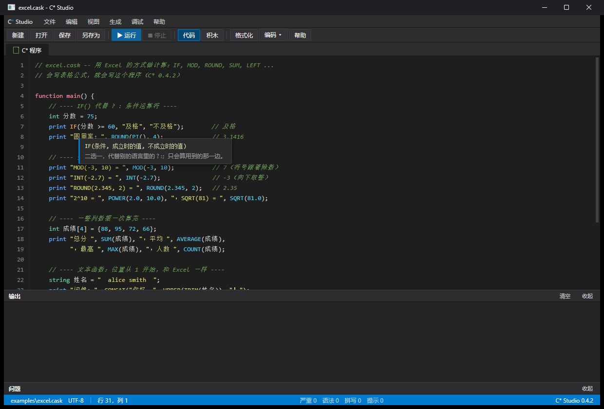
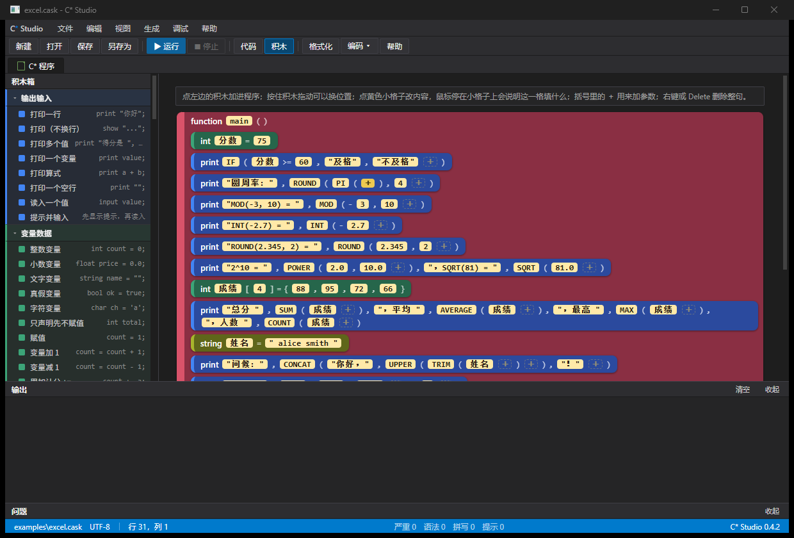

# C*（C Asterisk）编程语言 · 使用说明书

> 版本 **0.5.0** — 一门语法像 C、关键字贴近初中英语词汇的小语言。
> 源文件后缀：`.cask`　编译器：`bin\caskc.exe`　编辑器：`bin\caskide.exe`
>
> 本文件是**速查手册**，把语言的每一处细节都列清楚。想跟着课学，选一本：
>
> | 教材 | 文件 | 适合谁 |
> |------|------|--------|
> | C* 小学版教程 | `docs\小学版教程.md` | 小学高年级，第一次学编程 |
> | C* 初中版教程 | `docs\初中版教程.md` | 初中，把语言系统学一遍 |
> | C* 语言 必修一 | `docs\普高教材必修一.md` | 普通高中信息技术课 |
> | C* 语言 选修一 | `docs\普高选修一.md` | 高中选修：算法与窗口程序进阶 |
> | C* 语言基础 | `docs\高职教程CStar语言基础.md` | 高职，面向就业 |
>
> **0.5.0 相对 0.4.2 的变化**
>
> * **新增 `use "C_IO.cash";`**：打开"文件与系统"工具箱——`readfile` / `writefile` /
>   `appendfile` / `fileexists` / `makedir` / `appdir` / `envget` / `launchwait`。
>   控制台程序也能用，不必先开窗口（见 5.4b）。
> * **界面美化在 Windows 上真正生效**：按钮改成 owner-draw 自绘，`csbg` / `cstext` /
>   `csfont` 能改按钮底色与文字；`csbg(窗口, 色)` 改窗口底色；输入框背景与文字底色
>   一致；`csfont` 按 DPI 把磅换算成像素，不再出现超大字号（见 5.6）。
> * 新增完整示例 `examples\mc_launcher.cask`：自动探测 Java、自动找 jar、记住配置、
>   启动 Minecraft，是 C_IO + C_CSS 的综合范例。
> * 汇编后端修正：`TRUE()` / `FALSE()` 参与表达式、`char` 右操作数符号扩展、
>   数组初始化超出长度、`INT64_MIN % -1` 崩溃、中文函数嵌套调用、
>   `--fast` 下字符自增漏检查；`--run` 现在会透传被运行程序的退出码。
> * 教材同步修订：五本教材新增文件读写与界面美化内容，并把"先翻译成 C 再交给 gcc"
>   的旧说明改为"直接生成 x86-64 汇编，用 as + ld 链接"。
>
> 更早的 0.4.2 带来了 C 风格类型名 `int / float / string / char`（旧名
> `number / real / text / letter` 仍可用）、`C_OPED.cash` 窗口头、`C_CSS.cash`
> 美化头、积木视图头文件插件和 Visual Studio 2026 深色编辑器界面。

---

## 1. C* 是什么

C*（读作 "C Asterisk"）是一门**入门友好**的编程语言：

| 目标 | 怎么做到的 |
|------|-----------|
| 像 C，好迁移 | 大括号、分号、运算符都和 C 一样 |
| 关键字看得懂 | `print` 打印、`int` 整数、`function main()` 主程序、`if/for/while` 照旧 |
| 两种写法，从简到繁 | **代码视图**写 `.cask`，**积木视图**拖积木，两个视图随时切换（见 3.4） |
| 运行安全 | 溢出、除零、数组越界都会**报错并指出出错行**，而不是乱算或崩溃 |
| 整洁易懂 | 局部变量自动初始化为 `0` / 空，先用后赋不会读到垃圾值 |
| 名字好写 | 变量名、函数名**可以用中文**（`number 苹果 = 3;`） |
| 跑得快 | `.cask` 直接生成 x86-64 汇编，再用 `as` + `ld` 链接成原生 exe（不经过 C 编译器） |

一个完整的例子：

```cask
// guess.cask -- 猜数字
function main() {
    int secret = now() % 100 + 1;
    int guess = 0;
    print "我想了一个 1 到 100 的数，猜吧！";
    while (guess != secret) {
        input guess;
        if (guess < secret) { print "小了"; }
        else if (guess > secret) { print "大了"; }
    }
    print "猜对了！";
}
```

---

## 2. 安装与目录

### 2.1 需要什么

* Windows 10/11（也支持 Linux/macOS，路径按 `/` 处理）
* **binutils**（`as` / `ld`；MinGW-w64：Dev-C++、MSYS2、w64devkit、Strawberry Perl 里都自带）。
  编译 `.cask` 只需要它们，**不需要 gcc**
* 只有**构建工具链本身**（`build.bat` / `build.sh`）才需要 gcc、g++
* 可选：Python 3（只在重新生成网页版说明书时需要）

### 2.2 目录结构

```
C_AS\
├─ compiler\
│   ├─ caskc.c        编译器源码（C 语言写成；前端 + 汇编后端入口）
│   ├─ asm_backend.inc  x86-64 汇编后端（.cask → .s，Windows/Linux 双 ABI）
│   ├─ cask_rt.c      控制台运行时（编译进 libcastrt.a）
│   ├─ cask_gui.c     窗口 / CSS 运行时（编译进 libcastrt.a）
│   ├─ cask_io.c      文件与系统运行时（编译进 libcastrt.a）
│   ├─ cask_rt.h      运行时语义基准与内建声明
│   ├─ C_OPED.cash    窗口程序头（use "C_OPED.cash"; 打开 C / Win32 世界）
│   ├─ C_CSS.cash     美化头（配 C_OPED 用）
│   └─ C_IO.cash      文件与系统头（控制台程序也能用）
├─ editor\
│   ├─ webide.c       C* Studio 编辑器宿主（原生窗口 + 本机网页服务 + 编译运行桥）
│   ├─ wv2.cpp        WebView2 接入层（把网页放进原生窗口里）
│   └─ webview2\      WebView2 SDK（头文件和 WebView2Loader.dll）
├─ web\               编辑器界面（网页：index.html / style.css / editor.js / app.js / blocks.js）
├─ docs\              说明书与教材（Markdown 是正文，html 由脚本生成）
│   ├─ CStar手册.md   速查手册（本文件）→ manual.html
│   ├─ 小学版教程.md / 初中版教程.md / 普高教材必修一.md
│   ├─ 普高选修一.md / 高职教程CStar语言基础.md
│   ├─ md2html.py     把上面的 .md 转成同名 .html
│   ├─ check_doc_code.py   把教材里每个完整例子真编译一遍
│   └─ images\        文档里的截图
├─ examples\          示例程序
├─ tests\             测试程序 + 期望输出
├─ vscode-ext\        VS Code 插件（让 .cask 有高亮和补全）
├─ dist\              打包好的发行文件（zip / vsix）
├─ bin\               build.bat 生成：caskc.exe、caskide.exe、libcastrt.a、libgcc.a、
│                     cask_rt.h、C_OPED.cash / C_CSS.cash / C_IO.cash、web\、WebView2Loader.dll
├─ build.bat          一键构建整个工具链
├─ run_tests.bat      跑全部测试
└─ README.md
```

### 2.3 构建

```bat
build.bat
```

会依次生成 `bin\caskc.exe`（编译器）、`bin\libcastrt.a`（预编译运行时）、
`bin\caskide.exe`（编辑器），并把 `libgcc.a`、`cask_rt.h`、三个 `.cash` 头和编辑器界面
（`web\` → `bin\web\`、`WebView2Loader.dll`）复制进 `bin\`。
构建工具链需要 `gcc` 和 `g++`；但**用户编译 `.cask` 时只需要 `as` / `ld`**，
链接的是已经编好的 `libcastrt.a`，不会再调用 C 编译器。
运行测试用：

```bat
run_tests.bat
```

重新生成网页版说明书（需要 Python 3）：

```bat
python docs\md2html.py
```

它会把 `docs\` 下的每一本 `.md` 都生成同名的 `.html`（手册固定叫 `manual.html`）：
小学版教程、初中版教程、普高教材必修一、普高选修一、高职教程，一次全部更新。
想检查教材里每个完整例子是否都能编译（**窗口程序只编译、不运行**，免得弹出窗口），可以跑：

```bat
python docs\check_doc_code.py docs\小学版教程.md
```

`build.bat` 还会把 `cask_rt.h`、`C_OPED.cash`、`C_CSS.cash`、`C_IO.cash` 和
`libcastrt.a` 复制到 `bin\`。这些文件必须和 `caskc.exe` 放在一起，编译出来的程序才跑得起来。

---

## 3. 快速上手

### 3.1 第一个程序

新建文件 `hello.cask`：

```cask
function main() {
    print "Hello, world!";
}
```

命令行编译并运行：

```bat
bin\caskc.exe hello.cask --run
```

看到 `Hello, world!` 就成功了。`--run` 会先编译再运行；不加 `--run` 则只编译出 `hello.exe`。

> 老写法 `start { say "Hello, world!"; }` 效果完全一样，`say` = `print`、`start { }` = `function main() { }`。

### 3.2 编译器常用命令

```bat
bin\caskc.exe 程序.cask              :: 编译成 程序.exe（生成 .s 后调用 as + ld）
bin\caskc.exe 程序.cask --run        :: 编译完立刻运行
bin\caskc.exe 程序.cask --console    :: 窗口程序里保留黑色控制台（方便 print 调试）
bin\caskc.exe 程序.cask -o 我的.exe  :: 指定输出文件名
bin\caskc.exe 程序.cask --emit-c 文件.c  :: 只写出生成的 C 代码（调试用，不编译）
bin\caskc.exe 程序.cask --keep       :: 编译成功后保留生成的 .s 汇编文件
bin\caskc.exe 程序.cask --fast       :: 关闭运行时检查（更快，但不安全）
bin\caskc.exe 程序.cask -g           :: 保留生成的 .s 汇编文件
bin\caskc.exe 程序.cask -v           :: 显示内部执行的 as / ld 命令行
bin\caskc.exe 程序.cask --check      :: 只检查不编译（不留下任何文件），有错退出码非 0
bin\caskc.exe 程序.cask --check --diag :: 再把每条问题按 P|行|列|信息 打出来
```

`--diag` 是给编辑器看的机器格式，一条问题一行，行首一个字母分级别：

| 字母 | 级别 | 意思 |
|------|------|------|
| `E` | **严重** | 程序跑不起来（语义错误：未定义的名字、类型不符……） |
| `S` | **语法** | 写法不对（少分号、括号不配对……），多数会自动"跳过错的地方"继续检查，**一次报多条** |
| `P` | **拼写** | 名字打错了，后面附"是不是想写 ×××"的建议（只在明显像的时候给） |
| `H` | 提示 | 老写法的提醒（比如还在用 `say`），不算错误 |

### 3.3 C* Studio 编辑器

双击 `bin\caskide.exe` 就打开编辑器（也可以把 `.cask` 文件名跟在后面：`bin\caskide.exe 我的.cask`）。
界面是 **Visual Studio 2026 深色风格**：顶部菜单栏（文件 / 编辑 / 视图 / 生成 / 调试 / 帮助）、
工具栏、文档标签页、下面停靠的「输出」「问题」工具窗口、底部蓝色状态栏——位置和 VS 一样，上手不费劲。
编辑器界面是一页网页，但它**装在一个真正的 Windows 窗口里**——程序在本机自己起了个小服务
（只认 127.0.0.1，不连外网），把 `bin\web\` 里的页面喂给窗口，所以既好看又好用。
万一 Windows 缺少 WebView2 组件（一般都自带），它会提示你，并改用默认浏览器打开同一界面，功能一样。



| 操作 | 说明 |
|------|------|
| `Ctrl+N` / `Ctrl+O` / `Ctrl+S` | 新建 / 打开 / 保存 |
| `Ctrl+Shift+S` | 另存为（第一次保存也会问存哪） |
| `F5` | 编译并运行 |
| `Esc` | 停止正在运行的程序 |
| `Tab` | 缩进四格 |
| `F1` | 帮助（快捷键小抄） |
| 工具栏「代码 / 积木」 | 两种视图来回切换（见 3.4） |
| 工具栏「格式化」 | 自动理清缩进、一句一行 |
| 工具栏「编码 ▾」 | 把当前文件转成 UTF-8 或 GBK 保存 |
| 点「问题」面板里的一条 | 光标跳到出错的那一行 |

**边写边查**：停下打字约半秒，编辑器就在后台悄悄跑一遍 `--check`，
底下「问题」面板列出每一条，行号栏上标出错的行；顶部四个小圆点实时计数：

* **严重**（红）——程序跑不起来的问题
* **语法**（橙）——写法不对；编译器会自动跳过错的地方，**一次给你看多条**
* **拼写**（绿）——名字打错了，会附"是不是想写 ×××"
* **提示**（蓝）——只是建议（比如你还在用老写法 `say`），不算错误

**运行**：按 F5 → 下面出现「输出」面板。编译有问题就停在问题面板；没问题就跑起来，
程序 `input` 的时候面板里出现输入框，打字按回车喂给程序；结束时显示 `[结束，退出码 0]`。
状态栏右侧依次是：文件名（改过会亮一个 ●）、编码、当前**行列**、四个计数、版本号。

保存编码放在菜单栏「**编辑**」里的 **转成 UTF-8（推荐） / 转成 GBK（给老环境）** 两项，
用来**立刻换一种编码保存**当前文件（例如把别人给的 GBK 文件转成 UTF-8，
好让中文变量名能被编译器接受）。工具栏上的「编码 ▾」按钮做的是同一件事。

**语法颜色按分类来**，和积木箱的十类一一对应，扫一眼就知道这个词是干什么的。
配色沿用 **Visual Studio 2026 深色主题** 的标记色（像 VS 里写代码的样子），
并额外给"变量名"上一档**亮蓝**——代码扫一眼就能分清关键字、函数、变量：

| 颜色 | 分类 | 例子 |
|------|------|------|
| 青 | 输出输入 | `print` `show` `input` |
| 蓝 | 变量数据 | `int` `float` `string` `char` `bool` `constant` |
| 浅绿 | 运算 | `SUM` `ABS` `MOD` `ROUND` `ATAN2`，还有数字本身 |
| 紫粉 | 判断 | `if` `else` `switch` `case` `true` `false` `and` `or` `not` |
| 黄褐 | 循环 | `while` `for` `foreach` `break` `continue` |
| 黄 | 函数 | `function` `return`，以及你自己定义、自己调用的函数名 |
| 橙 | 字符串与数组 | `LEN` `FIND` `SUBSTITUTE` `CONCAT`，还有字符串字面量 |
| 天蓝 | 窗口程序 | `use`、`window` `button` `label` `settext` 这些（见第 5 章） |
| 紫 | CSS 美化 | `cstext` `csbg` `csfont` `csapply` `cspass` …（见 5.6，要 `use "C_CSS.cash";`） |
| 灰 | 其它 | 积木箱里「其它」那一类的积木；代码里暂时没有归到这一类的词 |

**变量名是亮蓝**（不是上面任何一类）；当前所在行有一道**淡蓝横条**；
光标停在某个括号上时，**配对的括号会一起描灰边**——这几个和 Visual Studio 一样。

注释（`// …` 和 `/* … */`）用 VS Code 那样的**绿色斜体**，在积木视图里也是一块能点改的绿色积木。

**鼠标停在词上会告诉你它是干什么的**：旁边冒出一张小卡片，上排是这个函数的写法，
下排是说明。停在 `print` 上是 `print 值1, 值2 …;`——"打印这些值，打印完换行"；
停在 `LEN` 上是 `LEN(文字)`——"文字长度。按字节算，一个汉字算 3"。
忘了哪个函数怎么用，鼠标停一下就行。

选中的文字用**半透明的蓝底**，底下的彩色文字照样看得清；左边行号栏上出错的行标红。
Tab 缩进、回车自动对齐空位（上一行有 `{` 会自动多缩一层）。
UTF-8 和系统编码（如 GBK）保存的 `.cask` 都能正确打开和保存。

### 3.4 积木视图（Blocks）

点工具栏「**积木**」（或按 F1 里的快捷说明切换）就能在**代码**和**积木**之间切换：



* 左边是**积木箱**，分成 10 类：输出输入、变量数据、运算、判断、循环、函数、
  字符串与数组、**窗口程序**、**CSS 美化**、其它；每类默认收起，点一下展开。判断/循环类里有
  `if`、`while`、`for`、`until`、`do…while`、`foreach`、`switch/case/default` 这些新老积木；
  「窗口程序」「CSS 美化」这两类是**头文件插件**：程序里 `use` 了 `C_OPED.cash` /
  `C_CSS.cash` 它们才出现，没 `use` 就不显示（像没装的插件；「其它」里有
  "安装窗口插件""安装 CSS 插件" 两个入口积木，点了对应分类才装上）。
* **加入**：点一块积木就插进程序里（插在当前选中的积木后面，没选就插在末尾）；
  也可以直接把它**拖到画布**上想要的位置松开。
* **移动**：拖动画布里的积木换位置——拖动时有一个半透明**影子**跟着鼠标走，
  落点处亮一条黄色**插入线**，松开后积木带一个短暂的落位动画。
* **修改**：积木上的黄色小格子（变量名、数字、字符串、条件……）**点一下**就地变成输入框，
  回车确定、`Esc` 取消；提交后代码立刻改写。**鼠标停在小格子上会说明这一格填什么**：
  比如停在 `button("确定", 20, 20, 100, 30)` 的第 4 个格子上，卡片会写「宽」；
  停在 `int count = 0;` 的两个格子上，分别写「变量名」和「初始值」。
* **往括号里加东西**：括号里那个小小的黄色 **＋** 就是干这个的。空括号里点它
  （比如 `function 打招呼()`），敲 `string 名字` 回车，就成了 `function 打招呼(string 名字)`；
  已经有内容的括号末尾也有一个 ＋，点它再敲一个参数，逗号会自动补上：
  接着敲 `int 年龄`，就成了 `function 打招呼(string 名字, int 年龄)`。
  入口 `function main()` 的括号例外——`main` 不能带参数，所以那里没有 ＋（见 4.7 与第 6 章）。
* **删除**：单击选中（黄边），按 `Delete`。带 `{ }` 的积木连同里面的一起删。
* **复制 / 粘贴 / 剪切**：选中一块积木，`Ctrl+C` 复制、`Ctrl+X` 剪切（复制后原积木还在，
  剪切则移除）、`Ctrl+V` 粘贴到选中积木后面（没选中就进 `main` 里）。
* **撤销 / 重做**：`Ctrl+Z` 撤销上一步、`Ctrl+Y`（或 `Ctrl+Shift+Z`）重做；积木视图里每次
  增删、改格子、拖放都记进历史，可以连退几步再连进几步（代码视图里 `Ctrl+Z` 直接走编辑框自己的撤销）。
* 语句按嵌套一层层缩进，带身体的判断/循环画成包住身体的 C 形。
* **注释积木**：`// …` 和 `/* … */` 会画成一条绿色的斜体积木，显示注释原文；
  点它就能就地改写（写正文会自动补上 `//`），所以注释在积木视图里也能改、能删、能拖动。
* **use 积木拉线**：一条 `use "头文件";` 积木右边会拉出一条线，连到画布右侧一个独立信息方框，
  方框里写这个头文件的名字、一句话概述、依赖（要先 use 谁）和「已扫描」状态；
  这个方框在所有积木框**外面**，线从 use 积木右边缘穿过去连到它。

**重要**：积木视图和代码视图是**同一个程序**——积木里做的每个动作都会立刻改写代码文本，
再重新解析成积木。也就是说，**代码永远是真身**，积木只是它的一种好看的样子；
两边永远不会"对不上"。注释行和空行在积木视图里会藏起来（免得乱），切回代码视图还在。

积木视图能显示的是**语句级**结构（一块积木 = 一条语句）。想写复杂表达式，
改积木上的黄色格子（那是一整段代码文字），或者切回代码视图直接写——两种办法等价。

---

## 4. 语言基础

### 4.1 程序入口与注释

* 每个程序必须有**入口**，程序从这里开始执行：

  | 写法 | 说明 |
  |------|------|
  | `function main() { ... }` | **推荐写法**，一眼就能看懂它是"主函数" |
  | `start { ... }` | 老写法，完全等价 |
  | `number main() { ... }` / `int main() { ... }` | 写成 C 的样子也行（里面的 `return 3;` 就是退出码） |

  入口不能带参数；括号里写了东西编译器会提示 `'function main' 不要参数`。
* 入口块里可以 `return 整数;` 作为退出码，不写就是 0。
* 注释：`// 一行` 和 `/* 多行 */`，与 C 完全相同。

### 4.2 五种基本类型

| C* 类型 | 含义 | 对应 C | 取值范围 |
|---------|------|--------|----------|
| `int` | 整数 | `long long` | -9223372036854775808 … 9223372036854775807 |
| `float` | 小数 | `double` | 约 ±1.8e308 |
| `string` | 字符串 | `char *` | 不限长度，**不能原地修改** |
| `char` | 一个字符 | `char` | -128 … 127 |
| `bool` | 真假 | `int` | `true` / `false` |
| `none` | 无返回值 | `void` | 只用于函数类型 |

```cask
int n = 42;
float r = 2.5;
string s = "hello";
char c = 'A';
bool ok = true;
```

**名字换了（0.4.2）**：类型的规范名字是 `int` / `float` / `string` / `char`——就是 C 的说法，
学过 C 的人一眼就懂。0.2 / 0.3 用的 `number` / `real` / `text` / `letter` 现在是**软弃用别名**：
照样能编译，只是编辑器会在「提示」（H）里建议你换新名。

| 老名字 | 新名字 | 含义 |
|--------|--------|------|
| `number` | `int` | 整数 |
| `real` | `float` | 小数 |
| `text` | `string` | 字符串（一段文字） |
| `letter` | `char` | 一个字符 |

`bool` 和 `none` 没有改名。**新写的程序一律用新名字。**

* 字符串用双引号，字符用单引号，支持转义 `\n \t \r \\ \" \' \0 \x41 \101`。
* `string` 的所有运算（`+` 拼接、比较）都返回**新的字符串**，原串不会被改坏。
* 赋值成 `char` 时会检查数值是否在 -128…127，超出会报运行时错误（字面量在编译期就报）。

### 4.3 变量

* 声明格式：`类型 名字 [= 初值];`，可逗号连写：`int a = 1, b = 2;`
* 名字可以用**中文**：`int 苹果 = 3;`、`string 同学 = "小明";`（要求文件保存为 UTF-8）
* **自动初始化**：没写初值时，数字/布尔是 `0`，`string` 是空（NULL），数组全 0。
* 作用域：块 `{ }` 内声明的变量出了块就没了；内层可以**同名遮蔽**外层。
* 全局变量写在入口（`function main()` / `start`）之外，任何函数都能读写。
* 名字不能和 C 关键字、常用库函数名（`printf`、`main`…）、`cask_`/`__cask` 前缀冲突。
  中文名字请把源文件保存为 **UTF-8**，否则编译器会提示
  `名字里有非 ASCII 字母，文件要存成 UTF-8`。

### 4.4 常量

```cask
constant int MAX = 100;         // 也可以写 const int MAX = 100;
constant float PI = 3.14159;
constant string NAME = "C*";
```

* 常量值必须是**编译期能算出来的表达式**：字面量、四则运算、别的常量。
  函数调用、变量、下标都不行（错误信息会说明）。
* 常量名全程序唯一，而且**变量不能和常量同名**——防止误改。
* 数组长度可以直接用常量：`int table[ROWS][COLS];`

### 4.5 运算符

和 C 一样（优先级也一样）：

* 算术 `+ - * / %`（整数除法截断，如 `7/2 == 3`；除 0 报错）
* 比较 `== != < <= > >=`（结果是 `bool`）
* 逻辑 `and` `or` `not`（别名 `&& || !`）
* 位运算 `& | ^ ~ << >>`（`<<` 会检查溢出）
* 赋值 `=` 与复合赋值 `+= -= *= /= %=`（`&= |= ^= <<= >>=` 也支持）
* 自增自减 `++ --`（前缀后缀都可以）
* **没有三目运算符 `? :`**——“二选一的值”写成 `IF()` 函数（见 4.10），
  这样和 Excel 的 `IF(条件, 真值, 假值)` 完全一致

```cask
int i = 0;
i++;                 // 1
i += 10;             // 11
string t = IF(i >= 10, "大", "小");
```

### 4.6 流程控制

```cask
if (分数 >= 60) { print "及格"; }
else if (分数 >= 80) { print "良好"; }
else { print "加油"; }

while (i < 10) { i++; }

for (int j = 0; j < 10; j++) {
    if (j % 2 == 0) { continue; }
    if (j > 7) { break; }
}
```

* `for` 的三个部分都可以省略；第一段允许写多个声明（逗号分隔）。
* `break` / `continue` 用法与 C 相同。
* 条件必须是 `bool`（或能变成 bool 的比较结果），数字不能直接当条件——想要"非 0 即真"请写 `n != 0`。

还有四种（0.3 新增），都是从 C / Python 搬来的常见写法：

```cask
do {                       // 至少做一次：先做再问
    print n;
    n = n + 1;
} while (n < 3);

until (n >= 3) {           // 做到条件成立为止（= while (条件不成立)）
    n = n + 1;
}

foreach (s in scores) {    // 把一维数组每个元素轮流交给 s
    print s;
}

switch (score / 10) {      // 一个值对多个"格子"
    case 10: print "perfect"; break;
    case 9:  print "great";   break;
    default: print "keep trying";
}
```

* `do…while` 和 `until` 都**至少执行一次**再判断；`until` 和 `while` 正好相反——
  条件**成立就停**。
* `foreach (名字 in 数组)` 只支持**一维数组**，循环里可以直接改元素；
  两层嵌套可以套着写，每层用自己的名字。
* `switch` 的 `case` 后面必须是**编译期算得出来的常量**（字面量、`constant`、四则运算）；
  每个 `case` 末尾写 `break;` 跳出（`return` 也算结束）；`default:` 最多一个，可省略。

### 4.7 函数

```cask
int add(int a, int b) {
    return a + b;
}

function greet(string who) {        // 不返回值的函数可以写 function 开头
    print "Hello, ", who, "!";
}

none bye(string who) {              // 也可以像 C 一样写 none（= void）
    print "Bye, ", who, "!";
}

// 可以先用后定义（编译器会先扫一遍）
function main() {
    print add(2, 3);
    greet("world");
    bye("world");
}
```

* 返回类型写 `none` 表示不返回值（对应 C 的 `void`）；写 `function` 开头表示"这是个函数，
  不用返回值"——两种写法都行（`func` 是 `function` 的简写）。
* 参数是**按值传递**的：`string` 传指针但不可改，`int/float/char/bool` 复制。
* 所有路径都必须 `return`（忘了写，编译器会在末尾补一个安全的 `return 0`，不会返回垃圾值）。
* 函数不能递归到"无限"以外的未定义行为：递归和 C 一样快（`fib(20)` 秒出）。

### 4.8 数组

```cask
int a[5] = {10, 20, 30, 40, 50};
string names[3] = {"ann", "bob", "cat"};
int table[3][4];               // 二维
int b[4];                      // 自动全 0

for (int i = 0; i < 5; i++) {
    print a[i];
}
```

* 长度必须是整数或常量 `int`；每维最多 8 维。
* **下标越界立刻报错**并指出文件和行号（`--fast` 会关掉检查）。
* 一维数组可以整表初始化 `= {…}`；不初始化则全 0。

### 4.9 输入输出

```cask
print "结果：", x, " 和 ", y;   // 输出各值，最后换行
print "完成";                    // 输出并换行
show "请输入：";               // 只输出，不换行
input 年龄;                    // 读一行，自动按类型解析
```

* `print` 后面可以跟任意多个值（int/float/string/char/bool），**自动换行**。
* `say` 是 `print` 的老名字，两者完全一样，看到不用奇怪。
* `show` 不换行，常和 `say` 搭配排版。
* `input` **每次读一整行**：数字行必须是数字，否则提示重输；字符串读整行（可含空格）；`char` 取该行第一个非空字符。
* 这样设计后，数字、文字、字符输入挨着写也不会互相吃掉换行。

### 4.10 内建函数

| 函数 | 说明 | 例子 |
|------|------|------|
**小写数学函数（软弃用别名，编译时提示改用大写）**：

| 函数 | 说明 | 替代 |
|------|------|------|
| `len(文字)` | 长度（字节数） | `LEN` |
| `at(文字, i)` | 第 i 个字符（越界报错） | `at`（保留） |
| `abs(x)` | 绝对值 | `ABS` |
| `sqrt / pow` | 平方根 / 幂 | `SQRT` / `POWER` |
| `sin cos tan asin acos atan` | 三角函数（real，弧度） | `SIN COS TAN ASIN ACOS ATAN` |
| `log log10 exp` | 自然对数 / 常用对数 / e 的幂 | `LN` / `LOG10` / `EXP` |
| `floor ceil round` | 向下取整 / 向上取整 / 四舍五入 | `FLOOR` / `CEILING` / `ROUND` |
| `random()` | 0.0 ~ 1.0 随机数 | `RAND()` |
| `now()` | 当前时间戳（秒） | `now()`（保留） |

#### Excel 风格函数（大写，与 Excel 同名同义）

会用 Excel 就会写——同名函数含义一致，表格里的公式可以直接搬进程序：

| 类别 | 函数 | 说明 |
|------|------|------|
| 逻辑 | `IF(条件, 真值, 假值)` | 二选一（**代替 `? :`**，只计算用到的一边） |

**0.4.2 新增内置函数**（补齐 Excel / 常用数学文本能力，缺的直接补上）：

| 函数 | 说明 |
|------|------|
| `ATAN2(y, x)` | 由 y、x 求角度（弧度） |
| `TRUNC(x)` | 截断小数（向 0 取整） |
| `LOG10(x)` | 常用对数（底 10） |
| `FIND(文字, 要找的[, 起点])` | 位置（从 1 起），找不到给 0（区分大小写） |
| `SUBSTITUTE(文字, 旧, 新)` | 把"旧"全部换成"新" |
| `REPT(文字, 次数)` | 把文字重复几遍 |
| `EXACT(a, b)` | 两段文字逐字节是否完全一样 |
| `CHAR(编号)` / `CODE(文字)` | 编号（0..255）<-> 字符 |

Excel 大写的 `SIN COS TAN ASIN ACOS ATAN FLOOR CEILING` 现在也都认（和小写含义相同）。
小写老写法（`abs`、`len`、`sin`、`floor`、`ceil`、`log10`…）保留为**软弃用别名**，照常能编译，
`--check --diag` 时会提示改大写的规范名。

#### 彩蛋函数 `rcl`

`rcl` 是一个内置的彩蛋函数：不用 `use`、不用写函数体，直接调用。语义：
**空参 `rcl();` 打印 `方程235永远爱rcl！` 并立刻结束整个程序**；对上暗号则回一句话；其它值什么都不做。

| 写法 | 结果 |
|------|------|
| `rcl();` | 打印 `方程235永远爱rcl！`，然后**立刻结束整个程序** |
| `rcl(235);` / `rcl(235.0);` | 打印 `方程235 爱 rcl` |
| `rcl("FC235");` 等认得的字符串 | 打印 `方程235 爱 rcl` |
| `rcl("rcl");` | 打印 `rcl，方程235永远爱你！` |
| 别的值（`rcl(1);`、`rcl("hello");`） | 什么也不做，程序继续 |

认得的字符串暗号（**不分大小写**）：`235`、`方程235`、`FangCheng235`、`ZFC235`、`JF235`、`JF`、`FC235`、`FC`、`ZFC`、`FangCheng`。
参数只能是 0 个或 1 个；给两个参数会报错。返回值是 `int` 0。
| | `AND(a, b, …)` `OR(a, b, …)` `NOT(x)` | 与 / 或 / 非，参数必须是比较结果 |
| | `TRUE()` `FALSE()` | 逻辑值 |
| 数学 | `ABS(x)` `SIGN(x)` | 绝对值 / 符号（-1、0、1） |
| | `MOD(a, b)` | 取余，**结果符号跟除数**（Excel 含义）：`MOD(-3, 10) == 7` |
| | `ROUND(x)` `ROUND(x, 位数)` | 四舍五入（保留小数的写法返回 `real`） |
| | `INT(x)` | 向下取整：`INT(-2.7) == -3` |
| | `SQRT POWER EXP LN LOG PI` | 平方根 / 幂 / e 的幂 / 自然对数 / 常用对数（`LOG(x, 底)` 可选底数）/ 圆周率 |
| | `RAND()` `RANDBETWEEN(a, b)` | 0~1 随机小数 / 两端都含的随机整数 |
| 汇总 | `SUM(数组)` `AVERAGE(数组)` `COUNT(数组)` | 求和 / 平均（返回 `real`）/ 元素个数 |
| | `MAX(...)` `MIN(...)` | 多个数比大小，或传整个数组 |
| 文本 | `LEN` `LEFT` `RIGHT` `MID` | 长度 / 两端取字 / 取子串（**位置从 1 开始**，同 Excel） |
| | `UPPER` `LOWER` `TRIM` | 变大写 / 变小写 / 去两端空格（中间连续空格并成一个） |
| | `CONCAT(a, b, …)` | 拼成一段文字（数字、逻辑值自动转换） |
| | `VALUE(文字)` `VAL(文字)` | 把文字转成整数（Excel 的 `VALUE`）：`VALUE("42") == 42`，开头不是数字就算 0 |

* 大写是 Excel 名字，小写是原来的名字：`ABS` = `abs`、`SQRT` = `sqrt`、
  `LEN` = `len`……两套都能用。
* **`%` 和 `MOD()` 并存但规则不同**：`-3 % 10` 是 **-3**（C 规则，跟被除数），
  `MOD(-3, 10)` 是 **7**（Excel 规则，跟除数）。
* `IF()` / `AND()` / `OR()` 的条件必须是**比较**（`x > 3`），
  想要“非 0 即真”请写 `n != 0`。
* `SUM/MAX/MIN` 等传的是**整个数组名**，不用写 `[ ]`。

```cask
int 分数 = 75;
print IF(分数 >= 60, "及格", "不及格");        // 及格
print "圆周率 ", ROUND(PI(), 4);               // 圆周率 3.1416
int 成绩[4] = {88, 95, 72, 66};
print "总分 ", SUM(成绩), " 平均 ", AVERAGE(成绩);  // 总分 321 平均 80.25
print TRIM(UPPER("  hello world  "));          // HELLO WORLD
```

### 4.11 引入头文件

```cask
use "my_helper.h";     // 引号里带路径/带 .h → 生成 #include "..."
use <stdio.h>;         // 尖括号 → 生成 #include <stdio.h>
```

生成的 C 文件会原样包含它们，所以能直接调用 C 库函数（进阶用法，注意类型要对得上）。

有一个头文件很特别：**`use "C_OPED.cash";`**——它一行就打开整个 C / C++ / Win32 世界，
让程序能建真正的窗口、弹窗、直接调用系统函数。详见第 5 章。

---

## 5. 窗口式程序：`use "C_OPED.cash";`

前面写的都是"黑底白字"的控制台程序。C* 0.4.2 起，只要在文件**最前面**写一行

```cask
use "C_OPED.cash";
```

就打开了 **C / C++ / Win32 的世界**：

| 打开之后 | 意思 |
|---------|------|
| 系统头文件已经包含 | 不用再写 `use <windows.h>;`，C / C++ 常用头文件都在了 |
| 可以直接调系统函数 | 头文件里的函数**不用声明**就能调，例如 `int t = GetTickCount();` |
| 自动链接窗口库 | user32 / gdi32 / comctl32 … 编译器替你带上 |
| 一套内建窗口控件 | `window` `label` `button` `textbox` … 见 5.2 |
| 生成窗口式 exe | 默认**不带黑色控制台**；想留着调试加 `--console` |

> **C# 用不了。** C# / .NET 没有 C 头文件，能打开的只有 C 和 C++ 两个世界。

### 5.1 第一个窗口程序

```cask
use "C_OPED.cash";

int 次数标签;
int 点击次数 = 0;

function on_click(int 控件) {                       // 按钮被点击时，C* 自动调用它
    点击次数 = 点击次数 + 1;
    settext(次数标签, "你点了 " + 点击次数 + " 次");
}

function main() {
    int 窗口 = window("我的第一个窗口", 460, 260);       // 标题, 宽, 高
    label("你好，C*！点一下按钮看看：", 24, 24, 400, 24); // 文字, x, y, 宽, 高
    次数标签 = label("你点了 0 次", 24, 56, 400, 24);
    button("点我", 24, 104, 140, 34);
    run();                                          // 显示窗口，等窗口关闭才结束
}
```

编译并运行（`examples\win_hello.cask` 就是这个例子）：

```bat
bin\caskc.exe examples\win_hello.cask --run
```

要点：

* `window` 建的窗口就是**主窗口**，之后建的控件都放在它里面，所以控件不用再写窗口号。
* 控件的位置、大小都用**像素**：`x, y` 是左上角坐标，`宽, 高` 是尺寸。
* 程序最后一定要 `run();` 进入**事件循环**——不然 `main` 一跑完程序就退出，窗口一闪就没了。
* 每个控件都有个**编号**（`window` / `label` / `button` 的返回值，从 0 开始），
  事件函数拿到的就是这个编号。

### 5.2 控件一览

| 函数 | 建的控件 | 说明 |
|------|---------|------|
| `window(标题, 宽, 高)` | 主窗口 | 返回窗口号 |
| `label(文字, x, y, 宽, 高)` | 文字标签 | 只显示；可以用 `settext` 改内容 |
| `button(文字, x, y, 宽, 高)` | 按钮 | 点了触发 `on_click` |
| `textbox(文字, x, y, 宽, 高)` | 单行输入框 | 文字改了触发 `on_change` |
| `memo(文字, x, y, 宽, 高)` | 多行文本框 | 同上，可以换行 |
| `checkbox(文字, x, y, 宽, 高)` | 复选框 | `checked` 读、`setchecked` 写 |
| `listbox(x, y, 宽, 高)` | 列表 | `additem` 加项；换选项触发 `on_change` |
| `progress(x, y, 宽, 高)` | 进度条 | `setvalue` 设进度、`getvalue` 读进度 |

读和写：

| 用法 | 意思 |
|------|------|
| `settext(控件, "文字")` | 把控件上的文字改成新的（标签、按钮、输入框都行） |
| `string s = readtext(控件)` | 读出输入框 / 文本框里的文字 |
| `settitle(控件, "标题")` | 改窗口标题（也能改别的控件的文字） |
| `additem(列表, "一项")` | 往列表里加一项 |
| `checked(勾选框)` | 勾上了 1，没勾 0 |
| `setchecked(勾选框, 1)` | 勾上 / 取消 |
| `setvalue(进度条, 50)` | 进度条走到 50（0…100） |
| `getvalue(进度条)` | 读出当前进度 |

> 读出来的是**文字**（`string`）。要当数字算，用 `VALUE()`：`int 答 = VALUE(readtext(输入框));`

### 5.3 事件：让窗口"活"起来

窗口程序不是从上往下跑完就结束，而是**等事情发生**——点了按钮、改了文字，C* 就去调对应的函数：

| 你写的函数 | 什么时候被调用 | 参数 |
|-----------|---------------|------|
| `function on_click(int 控件) { }` | 按钮被点击、列表里换了选项 | 控件编号 |
| `function on_change(int 控件) { }` | 输入框里的文字被改了 | 控件编号 |
| `function on_close() { }` | 用户点了窗口右上角的 × | 无 |

三个函数都是**可选的**：写了才会被调用，一个都不写也不算错。
`run();` 一直转，直到主窗口被关掉才返回。

```cask
use "C_OPED.cash";

int 输出框;
int 输入框;

function on_click(int 控件) {
    string 名字 = readtext(输入框);
    if (LEN(名字) == 0) { settext(输出框, "请先写个名字"); return; }
    settext(输出框, "你好，" + 名字 + "！");
}

function main() {
    window("打招呼", 420, 220);
    输出框 = label("请在上面写名字", 24, 24, 360, 24);
    输入框 = textbox("", 24, 60, 240, 26);
    button("打招呼", 24, 104, 120, 32);
    run();
}
```

### 5.4 弹窗、延时、直通系统函数

| 用法 | 意思 |
|------|------|
| `alert("内容")` | 弹一个只有「确定」的消息框 |
| `msgbox("内容", "标题")` | 同上，标题自己写 |
| `ask("问题？", "标题")` | 是 / 否 对话框：点「是」返回 1，点「否」返回 0 |
| `sleep(毫秒)` | 等一会儿（1000 = 1 秒） |
| `destroy(控件)` | 关掉一个控件或窗口 |
| `launch("命令行")` | 启动一个外部程序，**启动就返回**（不等它跑完）：1 = 起来了 |

因为 C / C++ / Win32 的头文件已经打开，**不用声明**就能直接调里面的函数：

```cask
use "C_OPED.cash";

function main() {
    int 毫秒 = GetTickCount();                // Win32：开机到现在的毫秒数
    if (毫秒 >= 0) { print "系统调用成功"; }
    MessageBoxA(0, "内容", "标题", 0);         // Win32 原生消息框，直接写
}
```

这类**直通调用** C* 不检查参数个数和类型（名字对不上就报"未知函数"；参数写错要到链接或运行时

才会暴露），写的时候对照函数说明或查一下 MSDN。

### 5.4b 文件与系统：`use "C_IO.cash";`

不用窗口也能用的"文件与系统"头：读写文件、判断存在、取程序目录、读环境变量、等外部程序跑完。

| 用法 | 意思 |
|------|------|
| `readfile("路径")` | 把整个文件读成一段文字（不存在给 `""`，上限 1MB） |
| `writefile("路径", 内容)` | 整体写入（覆盖），1 = 成功 |
| `appendfile("路径", 内容)` | 追加到末尾，1 = 成功 |
| `fileexists("路径")` | 文件或目录在不在：1 / 0 |
| `makedir("路径")` | 建目录（已有也算成功） |
| `appdir()` | 本程序（exe）所在目录的完整路径，不带末尾分隔符 |
| `envget("名字")` | 读环境变量（没有给 `""`） |
| `launchwait("命令行")` | 启动外部程序并**等它跑完**，返回退出码（起不来 -1） |

```cask
use "C_IO.cash";

number main() {
    string 配置 = appdir() + "/app.set";
    if (fileexists(配置) != 0) print "上次的内容: ", readfile(配置);
    writefile(配置, "名字=Steve" + "\n" + "内存=2048");
    print "写完了。";
    return 0;
}
```

`launch()`（5.4 节，启动就返回）和 `launchwait()`（本节，跑完才返回）是一对：

写启动器、下载器这类"发起就该继续干别的"的程序用前者；写批处理、想拿到退出码的用后者。

### 5.5 完整小项目：加法练习器

```cask
use "C_OPED.cash";

int 题目框;
int 答案框;
int 成绩框;
int 出题按钮;
int 检查按钮;
int 对的 = 0;
int 错的 = 0;
int 甲 = 0;
int 乙 = 0;

function 出一道题() {
    甲 = RANDBETWEEN(1, 20);
    乙 = RANDBETWEEN(1, 20);
    settext(题目框, 甲 + " + " + 乙 + " = ?");
    settext(答案框, "");
    settext(成绩框, "对 " + 对的 + " 题，错 " + 错的 + " 题");
}

function on_click(int 控件) {
    if (控件 == 出题按钮) { 出一道题(); return; }
    if (控件 != 检查按钮) return;
    if (VALUE(readtext(答案框)) == 甲 + 乙) {
        对的 = 对的 + 1;
        settext(成绩框, "答对了！");
    } else {
        错的 = 错的 + 1;
        settext(成绩框, "答错了，正确答案是 " + (甲 + 乙));
    }
    出一道题();
}

function main() {
    window("加法练习器", 480, 320);
    label("算一算：", 24, 20, 120, 24);
    题目框 = label("", 100, 20, 320, 24);
    答案框 = textbox("", 100, 60, 120, 26);
    检查按钮 = button("检查", 240, 58, 90, 30);
    出题按钮 = button("换一题", 340, 58, 90, 30);
    成绩框 = label("", 24, 110, 420, 24);
    run();
}
```

### 5.6 给窗口上妆：`use "C_CSS.cash";`

紧跟在 `use "C_OPED.cash";` 后面再加一行 `use "C_CSS.cash";`，
就打开了 CSS 式的美化工具箱（要两个头一起用）：

| 函数 | 作用 | 例子 |
|------|------|------|
| `cstext(控件, 色)` | 改文字颜色 | `cstext(提示, "FF6347")` |
| `csbg(控件, 色)` | 改背景颜色 | `csbg(输入框, "FFF9C4")` |
| `csfont(控件, 字号, 加粗)` | 字号（磅）＋粗细 0/1 | `csfont(标题, 24, 1)` |
| `csradius(控件, 像素)` | 圆角（Linux 生效） | `csradius(按钮, 8)` |
| `csshadow(控件, 0~3)` | 投影（Linux 生效） | `csshadow(窗口, 1)` |
| `cshide(控件) / csshow(控件)` | 隐藏 / 显示 | `cshide(标签)` |
| `cspass(控件)` | 输入框打码（密码框） | `cspass(密码框)` |
| `cscolor(名, 色)` / `csapply(名, 控件)` | 给样式起个名，再涂到别的控件上 | `cscolor("主题","1E88E5")` |

颜色写法和 CSS 一样：`"#RRGGBB"`、`"RRGGBB"`，或者颜色名（`"blue"` `"gold"` …）。

**0.5.0 起 Windows 上真正能改的地方**：

* 按钮：改成自绘（owner-draw），`csbg` 改按钮底色、`cstext` 改文字色、`csfont` 改字号，
  不再被 Win10/11 的视觉样式盖掉。
* 窗口：`csbg(窗口, "1B2129")` 会换掉窗口背景刷，整块底色都变。
* 输入框 / 多行框：返回背景刷的同时设置文字底色，内部不再是一块白。
* `csfont` 的字号按 **磅** 解释，并按屏幕 DPI 换算成像素（96 DPI 下 12 磅 ≈ 16 像素），
  不会再把 12 磅当成 240 像素。
* `csradius` / `csshadow` 仍只在 Linux（GTK）生效；Windows 上安全地当作没写。

深色主题的最小写法：

```cask
use "C_OPED.cash";
use "C_CSS.cash";

function main() {
    int 窗口, 标题, 启动钮;
    窗口 = window("深色示例", 420, 260);
    标题 = label("C* 0.5.0", 20, 20, 380, 40);
    启动钮 = button("开始", 20, 90, 160, 40);
    csbg(窗口, "1B2129");
    cstext(标题, "#E8EAED");
    csfont(标题, 22, 1);
    csbg(启动钮, "238636");
    cstext(启动钮, "#FFFFFF");
    csfont(启动钮, 12, 1);
    run();
}
```

```cask
use "C_OPED.cash";
use "C_CSS.cash";

function main() {
    int 窗口, 标题, 密码框;
    窗口 = window("登录", 460, 300);
    标题 = label("请登录", 24, 20, 412, 36);
    密码框 = textbox("", 108, 70, 328, 28);
    csswindow();
    csfont(标题, 24, 1);
    cstext(标题, "0000FF");
    cspass(密码框);
    run();
}
```

完整的登录窗口（账号／密码校验＋提示变红变绿）见 `examples\login.cask`，
自动结束版的演示见 `examples\css_demo.cask`（编辑器里点「运行」看得到输出）。

**用 CSS＋窗口做一个整台计算器**：`examples\calc.cask` 把第 5 章的窗口积木和第 5.6 节的
上色积木串起来，做成一台桌面整数计算器——深蓝显示屏、琥珀大数字、数字键/运算键/等号各配
一个颜色名（`cscolor` 起名、`csapply` 涂到对应按键上），再加 `csradius` 圆角、`csshadow` 投影。
有意思的是：C* 没有"数字转文字"的现成函数，代码里用 `CHAR`＋连接＋`LEFT`/`RIGHT`/`LEN`/`MOD`
等文本函数自己把整数拼成字符串，正好当文本函数的小练习。

```bash
bin\caskc.exe examples\calc.cask -o calc.exe --console   # 编译
calc.exe                                                  # 运行，点按键算数
```

### 5.7 窗口程序的调试小抄

| 情况 | 怎么办 |
|------|--------|
| 窗口一闪就没了 | 忘了写 `run();` |
| 想在窗口里看 `print` 的输出 | 用 `bin\caskc.exe 程序.cask --run --console` |
| 按钮点了没反应 | 检查 `on_click` 写没写、控件编号有没有对上（用变量存住编号） |
| 中文变成方块 / 乱码 | 源文件存成 UTF-8（菜单栏「编辑 → 转成 UTF-8」） |
| 提示 `找不到 'C_OPED.cash'` | `C_OPED.cash` 要和 `caskc.exe` 放在一起（`build.bat` 会自动复制） |

---

## 6. 安全机制（重点）

C* 默认打开三层运行时检查，出错时**程序立刻停止**，并打印：

```
C* 运行错误: 数组下标越界
  位置 tests\array.cask:6
```

| 检查 | 触发条件 | 例子 |
|------|---------|------|
| 整数溢出 | `int` 加/减/乘结果放不下 | `9000000000000000000 * 9` |
| 除零 | `/` `%` 的除数为 0 | `10 / 0` |
| 数组越界 | 下标 `<0` 或 `>=长度` | `a[5]` 只有 3 个元素 |
| 移位检查 | 移位位数不在 0…63，或左移负数/溢出 | `1 << 99` |
| 字符范围 | `int` 赋给 `char` 超出 -128…127 | `char c = 999;` |

* 错误信息里的文件和行号指向 **`.cask` 源文件**（汇编后端为每条检查记录了源码行号）。
* 追求速度、并且确认逻辑正确时可以 `--fast` 关闭这些检查（省一点点开销，出错行为不再保证）。
* 编译期问题分**三级**：严重 / 语法 / 拼写（另有不计错的"提示"）。都带
  `文件:行:列: 错误:` 格式；`--check --diag` 时按 `E|行|列|…`、`S|…`、`P|…` 打出。
  在 C* Studio 里点「问题」面板中的一条即可跳到出错的那一行。

---

## 7. C* 与 C 的对照速查

| C* | C |
|----|---|
| `int` | `long long` |
| `float` | `double` |
| `string` | `char *` |
| `char` | `char` |
| `bool` | `int`（0/1） |
| `none` | `void` |
| `print a, b;` | `printf("%lld%s", a, b); printf("\n");`（自动选格式） |
| `use "C_OPED.cash";` | `#include <windows.h>` + 链接窗口库 + 生成 `WinMain` |
| `input x;` | 按行读入并解析 |
| `function main() { }` | `int main(void) { … return 0; }` |
| `constant int N = 5;` | `#define N (5LL)` |
| `and or not` | `&& \|\| !` |
| `IF(条件, a, b)` | `(条件) ? (a) : (b)` |
| `MOD(a, b)` | 结果符号跟除数（C 的 `%` 跟被除数） |
| 越界/溢出 | 无检查（C 未定义行为） |

---

## 8. 常见问题

**Q：提示 `找不到 'C_OPED.cash'`？**
把 `C_OPED.cash` 放在 `caskc.exe` 同目录（`build.bat` 已自动复制到 `bin\`），
或设置环境变量 `CASK_RT_DIR` 指向那个目录。

**Q：窗口程序运行起来没有黑窗口，`print` 看不见？**
窗口程序默认是"窗口式"的，没有控制台，所以 `print` 的输出没地方显示。
调试时加 `--console`（或干脆用 `alert()` / 标签显示结果）：

```bat
bin\caskc.exe 我的窗口.cask --run --console
```

**Q：编译时提示找不到 `as` / `ld`？**
把 binutils 所在目录（MinGW-w64 的 `bin`）加进 PATH，或直接用 Dev-C++ 自带的 binutils。
编译 `.cask` 不需要 gcc；`gcc` 只在构建工具链本身时用到。

**Q：提示 `找不到 cask_rt.h`？**
把 `cask_rt.h` 放在 `caskc.exe` 同目录（`build.bat` 已自动复制），或设置环境变量 `CASK_RT_DIR` 指向它。

**Q：中文输出乱码？**
源文件保存为 **UTF-8**，C* 会自动把控制台切到 65001 代码页；保存为 GBK 也可以，程序会用默认代码页。两者不要混。

**Q：想用中文当变量名、函数名？**
可以，例如 `int 苹果 = 3;`、`function 打招呼(string 谁) { … }`。
要求文件保存为 **UTF-8**；如果存成了别的编码，编译器会提示
`名字里有非 ASCII 字母，文件要存成 UTF-8`。
（C\* Studio 状态栏会显示当前文件是 UTF-8 / ASCII / GBK；
如果文件是 GBK，用菜单栏「编辑 → 转成 UTF-8（推荐）」一键转换。）
纯英文的（ASCII）文件会自动按 UTF-8 保存，所以以后加中文名字不会有问题。

**Q：积木视图和代码视图会不会不一致？**
不会。积木是从代码文本解析出来的**视图**，你对积木的每次操作（拖入/删除/移动/双击改内容）
都是立刻改写代码文本再重新解析。**代码是唯一的真身**，随时可以切回代码视图核对。

**Q：`string` 能不能 `t[0] = 'X';` 这样改一个字？**
不能（这是有意的简化）。用拼接：`t = 前缀 + "X" + 后缀`，或改用 `char arr[]` 数组。

**Q：还写着 `number`，会不会哪天不能编译了？**
不会。`number` / `real` / `text` / `letter` 是**软弃用别名**，一直能编译；
只是 `--check --diag` 和 C\* Studio 的「问题」面板会给你一条 `H`（提示），建议换成新名字。
老项目可以慢慢改，不用一次性大改。

**Q：常量报"必须是……表达式"？**
常量是**编译期求值**的，只能放字面量、算术和其它常量；要运行期算的值请用普通变量。

**Q：想看等价的老式 C 代码？**
`bin\caskc.exe 程序.cask --emit-c out.c` 会写出一份仅供阅读的 C 参考代码；
正常编译走汇编后端，不产生 C，也不调用 C 编译器。想看真正生成的汇编用 `--keep`。

---

## 9. 关键字总表

| 类别 | 关键字 |
|------|--------|
| 程序 | `function` `main` `use` `constant` |
| 类型 | `int` `float` `string` `char` `bool` `none` |
| 输出/输入 | `print` `show` `input` |
| 流程 | `if` `else` `while` `for` `do` `until` `foreach` `in` `switch` `case` `default` `break` `continue` `return` |
| 逻辑 | `and` `or` `not` `true` `false` |

以上就是全部关键字——每个都是初中阶段的英语词。其余（`printf`、`for` 的括号）都是你已经会的 C。

**老名字全都还能用**，一个都不会突然失效：

| 老写法 | 新写法 | 说明 |
|--------|--------|------|
| `say` | `print` | 完全一样（打印并换行） |
| `start { … }` | `function main() { … }` | 完全一样（程序入口） |
| `func` | `function` | 完全一样 |
| `const` | `constant` | 完全一样 |
| `void` | `none` | 完全一样 |
| `number` | `int` | 完全一样（整数类型） |
| `real` | `float` | 完全一样（小数类型） |
| `text` | `string` | 完全一样（字符串类型） |
| `letter` | `char` | 完全一样（字符类型） |
| `&&` `\|\|` `!` | `and` `or` `not` | 完全一样 |

老写法现在算是**软弃用**：照样编译通过，但带 `--diag` 检查时会多给一条 `H|行|列|…` 的**提示**
（建议换成新写法），不计入错误、不影响退出码。新程序建议一律用新写法。

另外还有一整套**大写的 Excel 风格内建函数**（`IF` `MOD` `SUM` `LEFT`……，见 4.10）——
它们是函数名，不是关键字，不能当变量名用。

---

## 10. 在 VS Code 里写 C*

`vscode-ext\` 里是一个 VS Code 扩展（`c-asterisk`）：装上以后，`.cask` 文件会有

* 语法高亮（关键字、类型、内建函数、字符串、注释）
* 代码片段（输入 `main`、`print`、`for`、`if`… 按 Tab 就能展开成完整骨架）
* 括号自动配对、`//` 自动注释

安装方法：在 VS Code 里按 `Ctrl+Shift+P` → 输入 `Install from VSIX` → 选 `dist\c-asterisk-0.5.0.vsix`。
（在 `vscode-ext\` 目录里运行 `npx @vscode/vsce package` 也可以自己重新打包。）

想让它也能一键编译/运行，可以在 VS Code 的 `tasks.json` 里加一条调用 `bin\caskc.exe` 的任务，
或者在 VS Code 的集成终端里直接用 `bin\caskc.exe 程序.cask --run`。

---

*C* 0.5.0 · 源码与问题反馈见 `README.md`。*
